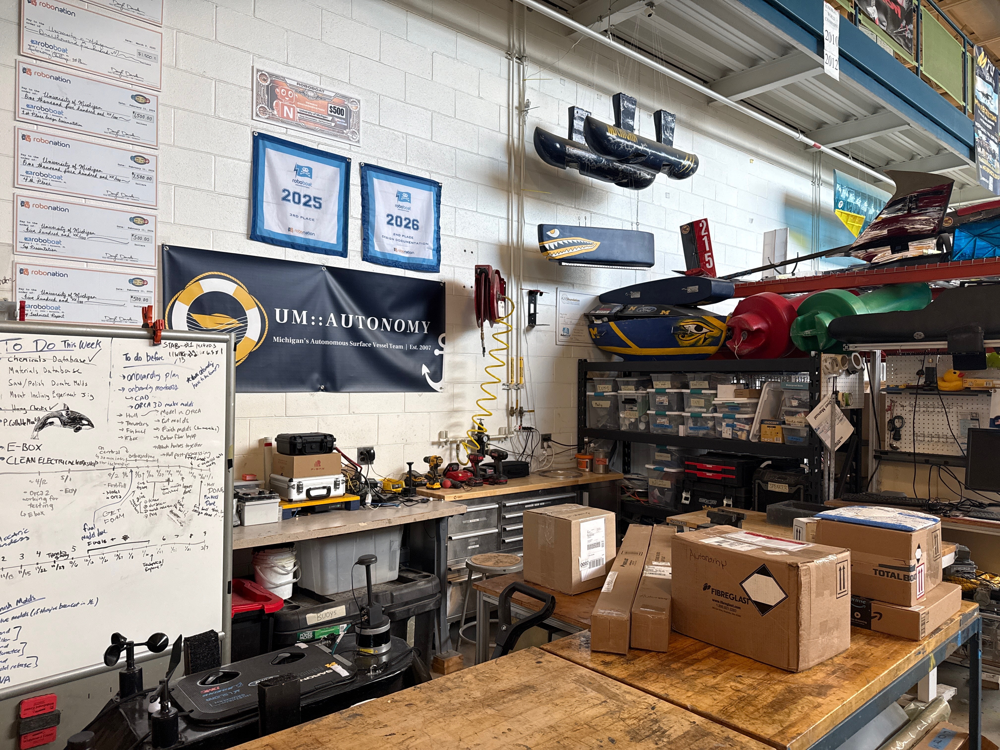
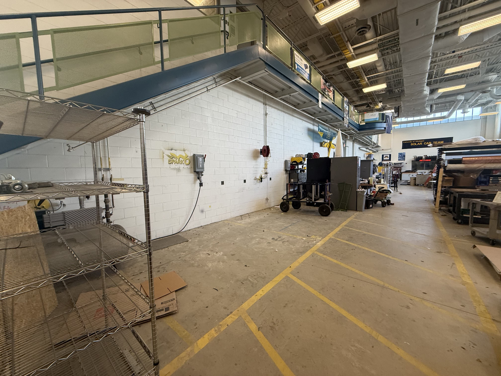

On October 25th, after some administrative changes across all teams, we finished moving to a new spot in the Wilson Student Team Project Center (where we do our manufacturing)! Above is our new area, closer to the shop bot and further from the mezzanine stairs. I myself really appreciate our more closed off laptop area. Goodbye loud generator thing, hello ominous cage! 

One last look at the old workspace!

A clean floor in our workspace ? !