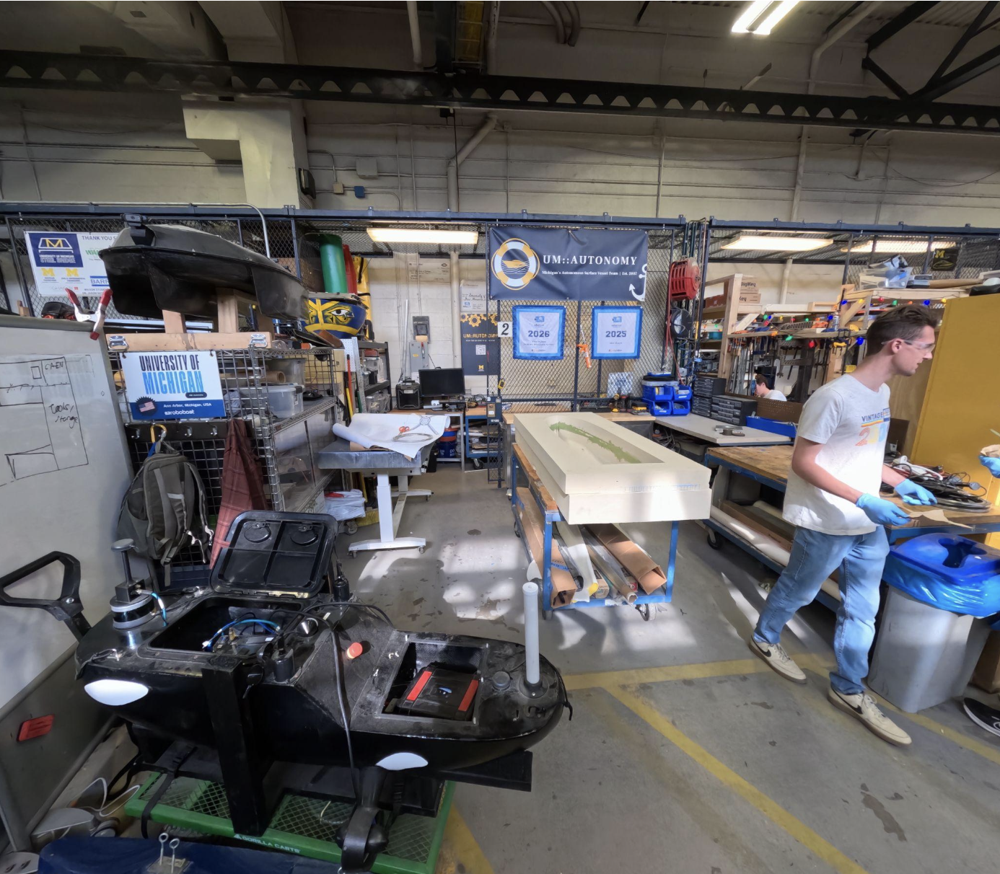
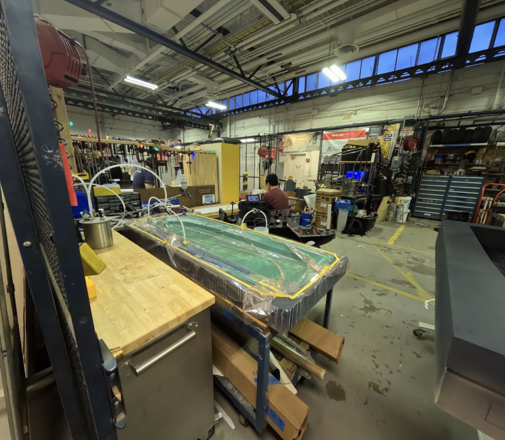
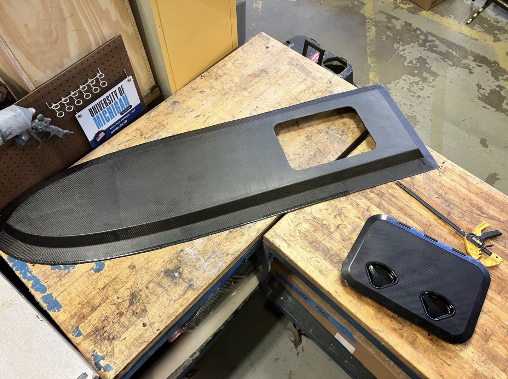

The mechanical team is off to a great start. They finalized the new vessel design at the end of August, and fabrication began after a four-week onboarding process for the new mechanical
team members. 

The team used a vacuum infusion technique on the deck mold, as shown below, and the hull mold is nearing readiness for the carbon fiber layup. 

Additionally, the team is developing several components for the boat, including a truss structure to support the camera, lidar, and antennas, as well as the pegboard and fin keel.

