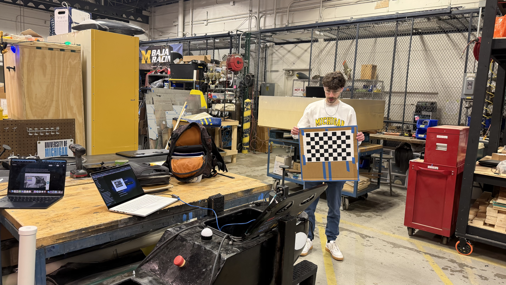
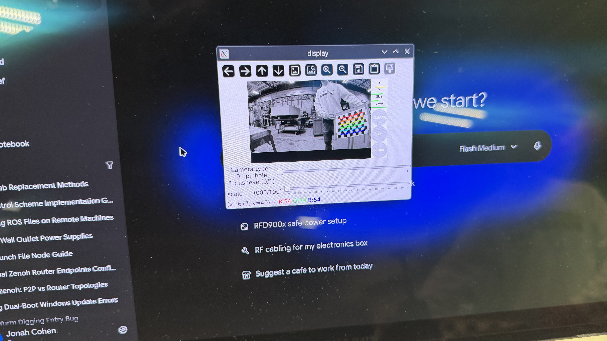

Get a sample of our weekly AI Lead meetups in the Wilson Center, our manufacting location! We receieved and hooked up our new beefy base station antenna which reduces reception to 120 degrees, which sohould help to focus data towards the boat's direction. We also recalibrated our camera, since we went through some sensor switching and wanted to make sure we didn't mess with any settings.

To calibrate the camera, we followed [this tutorial](https://medium.com/starschema-blog/offline-camera-calibration-in-ros-2-45e81df12555)! More comprehensive instructions for our specific codebase is in our [Notion](https://app.notion.com/p/369bb90cb3878099a6baf56be1f42e66?v=3f2bb90cb38780828bbe000cd3e3e3ed&source=copy_link) and [Google Drive](https://docs.google.com/document/d/1p22daDNyhgxSd912vpsjBK5l0b5pTKD8zqARk4Ei9NQ/edit?tab=t.6ig57nmktmxg).