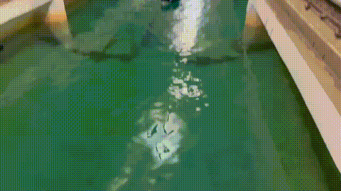
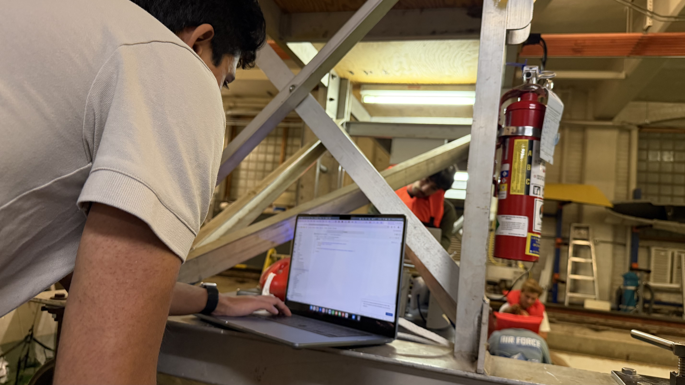
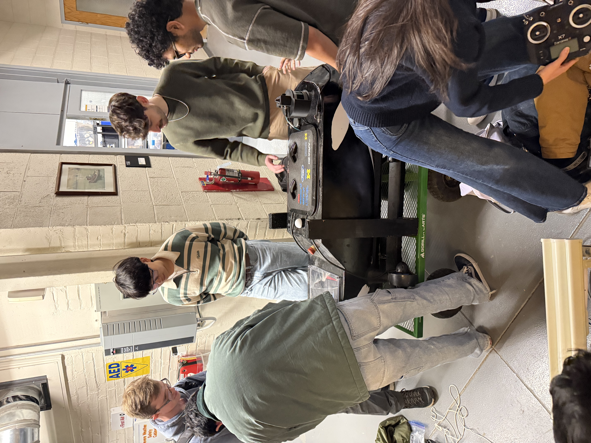
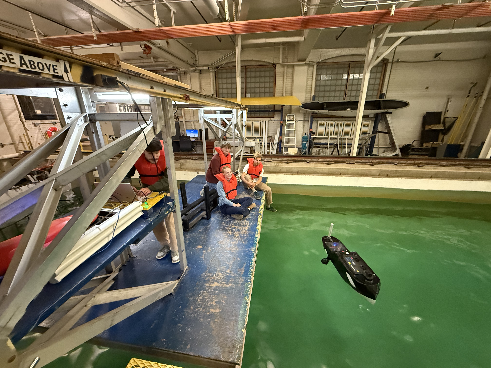
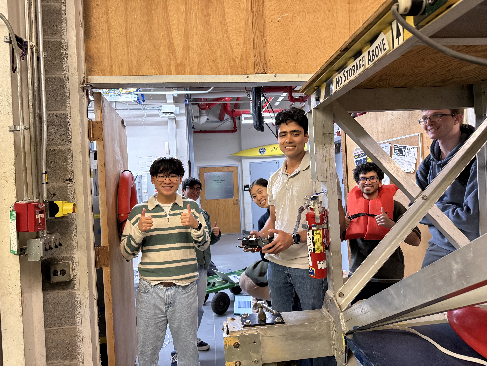
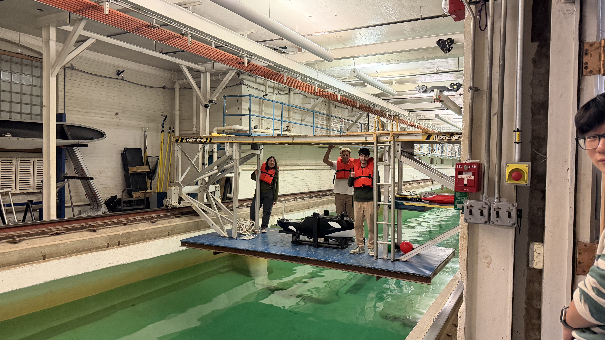

We had a great testing session in the MHL! We moved the boat around and tested our fixed e-box, our replaced indoor GPS modules, our new base station antenna, and our recalibrated camera and LIDAR.

